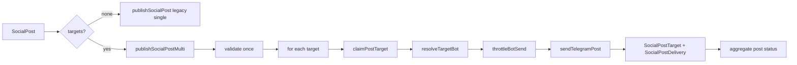

# Multi-destination Flow

> Scope: Telegram social publishing across multiple destinations.

## Overview

The multi-destination flow publishes a single `SocialPost` to **N Telegram destinations**
(channels, groups, forum topics) in one run. Each destination is tracked independently
through a `SocialPostTarget` row, while the parent post is aggregated into a final
status (`published`, `failed`, or partially sent).

Key characteristics:

- **Fan-out:** one post -> many targets (`SocialPostTarget`), resolved from active
  `SocialPublishRoute` rules for a platform (`resolvePlatformRoutes`).
- **Per-target idempotency:** each target is atomically claimed (`pending`/`failed` ->
  `sending`) before sending; concurrent publishers skip busy targets.
- **Independent delivery audit:** every attempt writes an append-only
  `SocialPostDelivery` row (history, never updated).
- **Partial success:** all targets sent -> `published`; all failed -> `failed`;
  otherwise the post stays `scheduled` with an aggregated `lastError`.
- **Backward compatible:** a post with zero targets falls back to the legacy single
  destination path (`publishSocialPost`).
- **Throttled sends:** per-bot spacing (default 100 ms) keeps traffic under
  Telegram's ~30 msg/s ceiling.

## Architecture

### Components

| Layer | File | Responsibility |
|---|---|---|
| Routing resolver | `src/lib/social/route-resolve.ts` | Active routes for a platform within time window; filters archived/disabled/unverified destinations |
| Multi publisher | `src/lib/social/publish-multi.ts` | Fan-out, claim, send, aggregate, edit, delete |
| Single publisher | `src/lib/social/publish.ts` | Legacy one-destination path + shared claim lease (`PUBLISH_LEASE_MS`) |
| Bot resolver | `src/lib/social/bot-resolve.ts` | Bot token resolution order + per-bot throttle |
| Send client | `src/lib/social/telegram-send.ts` | Telegram Bot API calls |
| Validation | `src/lib/social/validate-post.ts` | Content validation (caption limits, etc.) |
| Error catalog | `src/lib/publish-errors.ts` | Error codes, retryability, fix hints |

### Data model (relevant)

- `SocialPost` - parent post (`status`, `attempts`, `maxAttempts`, `lastError`, `externalId`).
- `SocialPostTarget` - per-destination row (`status`: `pending | sending | sent | failed | skipped`,
  `destinationId`, `botId`, `threadId`, `attempts`, `externalMessageId`).
- `SocialPostDelivery` - append-only attempt history.
- `SocialPublishRoute` - routing rule (`platformKey`, `targetType`, `destinationId`, `botId`,
  `isDefault`, `priority`, `isActive`, `validFrom`, `validUntil`, `threadId`).
- `SocialTelegramDestination` - destination (`chatId`, `status`, `verificationStatus`,
  `archivedAt`, `botId`, `messageThreadId`, `chatType`).

### Architecture diagram



## Data flow

### End-to-end sequence

```mermaid
sequenceDiagram
  participant Cron as Cron/Manual
  participant Multi as publishSocialPostMulti
  participant DB as Prisma/Postgres
  participant TG as Telegram API

  Cron->>Multi: postId
  Multi->>DB: load post + targets
  alt status already published/externalId
    Multi-->>Cron: skipped
  end
  alt no targets
    Multi->>Multi: publishSocialPost (legacy)
  end
  Multi->>Multi: validate post once
  alt validation fails
    Multi->>DB: mark all targets failed (permanent)
    Multi-->>Cron: failed
  end
  loop each target
    Multi->>DB: claim target (pending/failed -> sending)
    alt busy
      Multi->>DB: read current; skip
    else claimed
      Multi->>DB: resolve bot (target -> destination -> env)
      alt bot missing
        Multi->>DB: mark misconfigured (failed, no attempt)
      else ok
        Multi->>Multi: throttle (100ms per bot)
        Multi->>TG: sendMessage / sendPhoto / rich
        alt ok
          Multi->>DB: target=sent + delivery=sent
        else fail
          Multi->>DB: target=pending/failed + delivery=failed
          Multi->>DB: record publish errors
        end
      end
    end
  end
  Multi->>DB: aggregate post status (all sent / all failed / partial)
  Multi-->>Cron: MultiPublishResult
```

### Status aggregation rules

- `allSent` -> parent `status='published'`, `publishedAt=now`, `externalId=first sent message`,
  resolves open publish errors, notifies success.
- `allFailed` -> parent `status='failed'`, `lastError=aggregated`, notifies failure.
- Otherwise (partial) -> parent keeps `scheduled` (not failed) with aggregated `lastError`
  so retry can resume only failed targets; attempts incremented only if a send was attempted.

Previously sent targets are never re-sent (`status in ('sent','skipped')` -> skipped).

## Routing rules

Routing is resolved by `resolvePlatformRoutes(platformKey, now)` in
`src/lib/social/route-resolve.ts`:

1. Select `SocialPublishRoute` rows where:
   - `platformKey` matches.
   - `isActive = true`.
   - Time window: `validFrom` is null or `<= now`; `validUntil` is null or `> now`.
2. Order by `isDefault DESC, priority DESC, createdAt ASC`.
3. For each rule, validate the destination is usable:
   - destination exists and not archived (`archivedAt == null`);
   - `status === 'active'`;
   - `verificationStatus === 'verified'`;
   - thread consistency: if an effective thread id exists, destination `chatType` must be
     `group` or `supergroup` (forum topics only on groups);
   - bot rule: if `rule.botId` set, the bot must exist and be `active`.
   Unusable rules are counted in `excluded` and skipped.
4. Return `{ platformKey, defaultRuleId (first target's ruleId), targets[], excluded }`.

Effective thread id resolution: `rule.threadId ?? destination.messageThreadId ?? null`.

Routing rules are snapshotted into `SocialPostTarget` rows at scheduling time
(`src/app/api/creator/schedule-projects/route.ts` calls `resolvePlatformRoutes` and creates
one target per resolved destination). The publisher does not re-resolve routes; it reads
the snapshotted targets.

### Misconfigured target handling

A target is marked `failed` without consuming an attempt when:

- destination missing / archived / not verified / not active;
- thread bound to a non-forum destination;
- bot missing / inactive / token decrypt failure.

These are permanent-ish (no retry delay) but the error is recorded to the publish-error
log for the health dashboard.

## Error handling

Errors are classified by `classifyTransportError` in `src/lib/publish-errors.ts` into a
catalog code (e.g. `transport`, `validation_failed`, `rich_spec_invalid`,
`destination_missing`, `destination_archived`, `destination_not_qualified`,
`destination_thread_invalid`, `bot_missing`, `bot_not_active`, `bot_token_decrypt`).

Scopes recorded (`recordPublishError`):

- `post` - the SocialPost.
- `destination` - the SocialTelegramDestination.
- `bot` - the SocialTelegramBot (when a bot id exists).

Permanent (non-retryable) transport codes immediately move the target to `failed` instead
of staying `pending` for retry. Retryable errors keep the target `pending` with a 5-minute
backoff until `maxAttempts` is reached.

Partial failure aggregation: `aggregated = [...new Set(errors)].join(' | ').slice(0, 500)`.

## Retry strategy

- **Single publisher (`publishSocialPost`):**
  - Atomic claim: `updateMany` transitions to `publishing`; concurrent callers see `busy`
    and return `in_progress`. Lease `PUBLISH_LEASE_MS = 15 min` recovers crashed workers.
  - Transport failure: `attempts + 1`; if `attempts >= maxAttempts` -> `failed`, else
    `scheduled` with `scheduledFor = now + 5 min` (`RETRY_DELAY_MS`).
  - Non-retryable code -> immediate `failed` (no backoff).
  - Permanent validation/config errors -> `failed` with no attempt consumed.
- **Multi publisher (`publishSocialPostMulti`):**
  - Per-target claim with the same 15-min lease (`claimPostTarget`).
  - Transport failure per target: `pending` if retryable attempts remain, else `failed`;
    `exhausted = (attempts + 1) >= post.maxAttempts`.
  - Parent post stays `scheduled` on partial failure so the cron can re-run and only
    retry failed/pending targets (already `sent`/`skipped` are not re-sent).
  - Idempotency: post-level `status='published'` or `externalId` present -> skipped.

Cron entry point: `src/app/api/cron/social-publish/route.ts` (see `CRON-JOBS.md`).

## Rate limiting

- **Per-bot throttle:** `throttleBotSend(fingerprint, spacingMs=100)` in
  `src/lib/social/bot-resolve.ts` ensures at least 100 ms between sends for the same bot
  fingerprint (SHA-256 of token, truncated). Caps a single bot at ~10 msg/s, safely under
  Telegram's ~30 msg/s global cap.
- Throttle is in-memory (best-effort across instances) and keyed by token fingerprint
  (never the raw token).
- The multi publisher is sequential per target and calls `throttleBotSend` before each
  send, so even two concurrent runs serialize through the per-bot spacing.
- Tests can reset throttle state via `resetBotThrottleForTests()`.

## Testing

Existing tests covering this flow:

- `src/__tests__/telegram-delivery-integration.test.ts` - multi-destination success/partial
  failure scenarios.
- `src/lib/__tests__/schedule-projects.test.ts` - route resolution snapshotting into
  `SocialPostTarget`.
- `src/__tests__/media-consolidation-integration.test.ts` - media hub routing/UI.

Manual verification checklist:

1. Create 2+ verified destinations for a platform.
2. Create an active `SocialPublishRoute` per destination within a valid time window.
3. Schedule a post; confirm N `SocialPostTarget` rows created.
4. Run publish; confirm per-target `SocialPostDelivery` rows and aggregated parent status.
5. Re-run publish; confirm already-sent targets are skipped (no duplicate Telegram messages).
6. Disable one destination; confirm it is excluded (`excluded` count) and others still send.

## Troubleshooting

| Symptom | Likely cause | Fix |
|---|---|---|
| Post stuck `publishing` | Worker crashed mid-publish | Wait 15 min for lease expiry, then retry; or manually set status back to `scheduled` |
| All targets `failed` with `bot_missing` | No bot assigned and `TELEGRAM_BOT_TOKEN` unset | Assign a bot to the destination/target or set env token |
| Target `destination_not_qualified` | Destination not verified/active | Verify destination via health check; activate it |
| Thread error `destination_thread_invalid` | Thread id on non-group destination | Remove thread id or change destination to a group/supergroup |
| Partial publish never completes | Some targets failed but post stays `scheduled` | Inspect `SocialPostDelivery` + publish-errors; fix root cause, cron retries failed targets |
| Duplicate sends | Lease too short or clock skew | Increase `PUBLISH_LEASE_MS`; ensure DB clock sane |
| Rate limit (429) from Telegram | Throttle not applied or multiple processes | Ensure `throttleBotSend` called; reduce concurrency |

## Examples

### Resolve routes for a platform

```ts
import { resolvePlatformRoutes } from '@/lib/social/route-resolve'

const resolved = await resolvePlatformRoutes('pc', new Date())
console.log(resolved.defaultRuleId, resolved.targets.length, resolved.excluded)
for (const t of resolved.targets) {
  console.log(t.destinationId, t.chatId, t.threadId, t.botId, t.isDefault)
}
```

### Publish a post to all its targets

```ts
import { publishSocialPostMulti } from '@/lib/social/publish-multi'

const result = await publishSocialPostMulti(postId, { source: 'cron' })
console.log(result.ok, result.published, result.failed, result.skipped)
for (const t of result.targets) {
  console.log(t.targetId, t.status, t.externalMessageId, t.code)
}
```

### Throttle sends per bot

```ts
import { throttleBotSend, botTokenFingerprint, resetBotThrottleForTests } from '@/lib/social/bot-resolve'

await throttleBotSend(botTokenFingerprint(token), 100)
// resetBotThrottleForTests() // tests only
```
